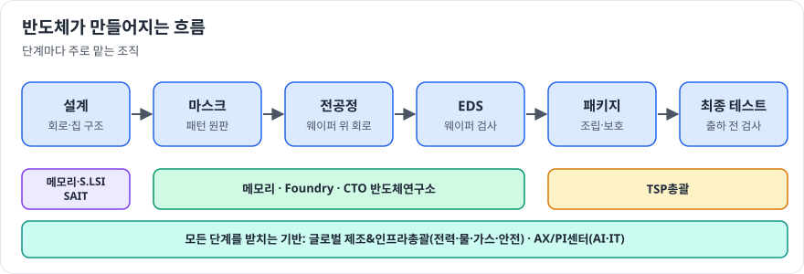
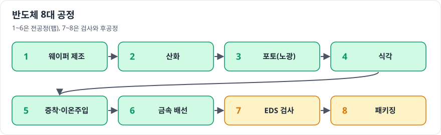
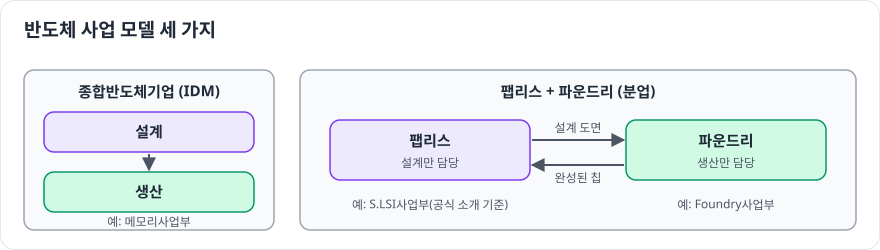

# 반도체 산업 한눈에 보기

> 이 장은 반도체가 처음인 독자를 위한 큰 그림입니다. 각 내용은 1부(사업부)와 2부(직무)에서 더 자세히 다룹니다.

## 반도체는 크게 두 종류

| 구분 | 메모리 반도체 | 시스템 반도체 |
|---|---|---|
| 하는 일 | 데이터를 **저장** | 데이터를 **계산·처리·제어** |
| 대표 제품 | DRAM, NAND Flash, HBM, SSD | 모바일 SoC, 이미지센서, 전력 관리 칩, 통신 칩 |
| 특징 | 표준화된 제품을 대량 생산, 가격 변동이 큼 | 제품 종류가 매우 다양, 설계 경쟁력이 핵심 |
| DS부문 조직 | [메모리사업부](../01-divisions/memory.md) | [S.LSI사업부](../01-divisions/slsi.md) |

## 반도체가 만들어지는 흐름

| 단계 | 하는 일 | 관련 조직 | 관련 직무 |
|---|---|---|---|
| 설계 | 회로와 칩 구조 설계 | 메모리, S.LSI, SAIT | 회로설계, 신호 및 시스템 설계, S/W개발 |
| 공정 개발 | 새 공정과 소자 개발 | CTO 반도체연구소, Foundry | 반도체공정설계, CAE시뮬레이션 |
| 전공정 (팹) | 웨이퍼 위에 회로를 새김 | 메모리, Foundry | 반도체공정기술, 설비기술 |
| 후공정 | 칩을 패키지로 만들고 검사 | TSP총괄 | 패키지개발, 평가 및 분석 |
| 공장 기반 | 전력, 물, 가스, 안전, 자동화 | 글로벌 제조&인프라총괄, AX/PI센터 | 인프라기술, 환경, 안전보건 |
| 사업 | 판매, 계획, 구매, 재무, 인사 | 각 사업부 | 영업마케팅, 생산관리, 구매, 경영지원, 인사 |

## 반도체 8대 공정

전공정과 후공정을 묶어 흔히 "8대 공정"이라고 부릅니다. 거의 모든 직무 면접에서 기본 상식으로 다뤄지므로 꼭 정리해 두세요.

1. **웨이퍼 제조**: 실리콘을 얇은 원판으로 만듦
2. **산화**: 웨이퍼 표면에 보호·절연막을 만듦
3. **포토 (노광)**: 빛으로 회로 패턴을 새김
4. **식각**: 필요 없는 부분을 깎아 냄
5. **증착·이온 주입**: 얇은 막을 쌓고, 불순물을 넣어 전기적 성질을 만듦
6. **금속 배선**: 소자들을 전기적으로 연결
7. **EDS (전기적 특성 검사)**: 웨이퍼 상태에서 칩을 검사
8. **패키징**: 칩을 잘라 포장하고 최종 검사

## 사업 모델 세 가지

| 모델 | 설명 | DS부문에서는 |
|---|---|---|
| **종합반도체기업 (IDM)** | 설계부터 생산까지 직접 | 메모리사업부 |
| **팹리스 (Fabless)** | 설계만 하고 생산은 외부에 맡김 | S.LSI사업부 (공식 소개 기준) |
| **파운드리 (Foundry)** | 다른 회사가 설계한 칩을 생산 | Foundry사업부 |

## 처음 공부할 때 추천 순서

1. 이 장의 표를 보고 관심 가는 단계를 고른다
2. 그 단계와 연결된 **사업부 장**을 읽는다
3. 사업부 장에 나온 **직무 장**으로 가서 학습 로드맵을 따라간다
4. 아직 모르겠다면 [3부. 나에게 맞는 직무 찾기](../03-job-matching/index.md)로 간다
