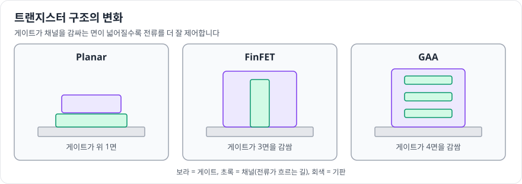

# Foundry사업부

> 확인 기준일: 2026-10-28 · 공식 사업부소개: <https://www.samsung-dsrecruit.com/recruits/division_intro/detail/foundry.php>

## 한 줄 요약

**다른 회사가 설계한 칩을 대신 만들어 주는 곳**입니다. 공정 기술만이 아니라 설계에 필요한 라이브러리, 설계 키트(PDK), 설계 서비스, 패키징까지 함께 제공하는 종합 파운드리를 지향한다고 소개합니다.

## 무엇을 만드나

파운드리는 고객이 설계한 칩을 생산합니다. 고객은 스스로 공장이 없는 팹리스 기업이 많습니다.

| 제공하는 것 | 설명 |
|---|---|
| **첨단 공정** | 가장 작은 트랜지스터로 고성능·저전력 칩 생산 (공식 소개에서 3nm GAA 공정 언급) |
| **특수 공정** | RF, 내장형 MRAM(eMRAM), 고전압, BCD(전력용), 이미지센서용 공정 등 |
| **설계 인프라** | 라이브러리, PDK, 설계 방법론, 설계 서비스 |
| **생태계** | 설계 도구·IP 파트너, 패키징·테스트 서비스 |

## 꼭 알아야 할 기술 키워드

| 키워드 | 한 줄 설명 | 왜 중요한가 |
|---|---|---|
| 공정 노드 (nm) | 공정 세대를 부르는 이름 | 세대가 바뀔수록 성능·전력·면적(PPA)이 개선 |
| GAA | 채널을 게이트가 사방으로 감싸는 트랜지스터 구조 | FinFET 이후 미세화를 이어 가는 핵심 구조 |
| EUV | 극자외선 노광 | 아주 작은 패턴을 새기는 데 필요 |
| PDK | 고객이 이 공정으로 설계할 수 있게 주는 설계 키트 | 고객이 설계하기 쉬워야 선택받음 |
| 수율 | 웨이퍼에서 정상 칩이 나오는 비율 | 고객 신뢰와 원가에 직결 |

## 이 사업부와 연결되는 직무

공식 소개에 나온 직무 기준입니다.

- **[회로설계](../02-jobs/design/circuit-design.md)**: 아날로그·디지털 IP 개발
- **[평가 및 분석](../02-jobs/design/test-analysis.md)**: 품질 보증, 고객 지원
- **[반도체공정설계](../02-jobs/process/process-integration.md)**: 공정 구조와 소자 개발
- **[반도체공정기술](../02-jobs/process/process-engineering.md)**: 양산 공정 관리, 수율 확보
- **[설비기술](../02-jobs/process/equipment.md)**: 장비 운영과 개선
- **[영업마케팅](../02-jobs/business/sales-marketing.md)**: 고객사·지역별 전략
- **[생산관리](../02-jobs/process/production-management.md)**: 생산 계획, 공급망
- **[패키지개발](../02-jobs/design/package.md)**: 고성능 패키지 설계와 시뮬레이션

## 요즘 이슈 읽는 법

1. **최첨단 공정 경쟁**: 어느 회사가 언제 다음 세대 공정을 양산하나, 수율은 어떤가
2. **고객**: AI 칩, 모바일 칩, 자동차 칩 고객이 어떤 기준으로 파운드리를 고르나
3. **패키징과의 결합**: 칩렛, 2.5D/3D 패키징까지 함께 제공하는 흐름

## 더 읽을거리

- 공식 사업부소개: <https://www.samsung-dsrecruit.com/recruits/division_intro/detail/foundry.php>
- 삼성전자 반도체 공식 웹사이트의 파운드리 소개: <https://semiconductor.samsung.com>
