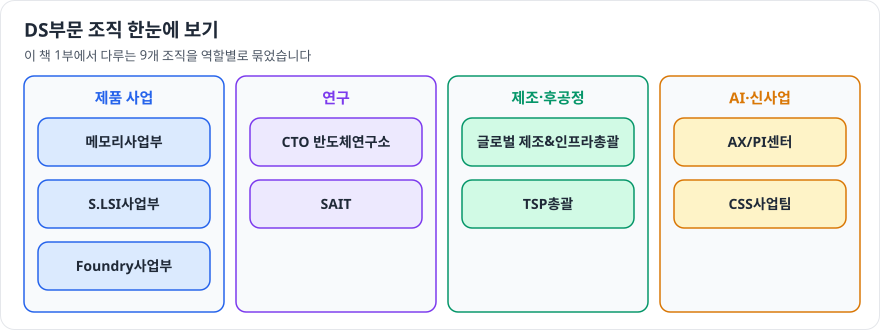

# 1부. 사업부 이해

DS부문의 사업부와 조직을 하나씩 살펴봅니다. 각 장은 무엇을 만드는지, 꼭 알아야 할 기술 키워드, 연결되는 직무 순서로 되어 있습니다.

- [메모리사업부](memory.md)
- [S.LSI사업부](slsi.md)
- [Foundry사업부](foundry.md)
- [CTO 반도체연구소](cto-semiconductor.md)
- [글로벌 제조&인프라총괄](manufacturing-infra.md)
- [TSP총괄](tsp.md)
- [AX/PI센터](ax-pi.md)
- [CSS사업팀](css.md)
- [SAIT](sait.md)
