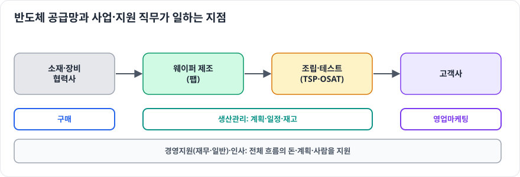

# 구매

> 확인 기준일: 2026-10-28 · 공식 직무소개: <https://www.samsung-dsrecruit.com/recruits/job_intro/testPackage_center/buy.php>

## 1. 이 직무는 무슨 일을 하나

반도체를 만들려면 웨이퍼, 가스, 화학 약품, 부품, 장비, 그리고 외주 조립·테스트(OSAT) 서비스까지 수많은 것을 사야 합니다. 구매는 **필요한 것을 필요한 때에, 좋은 품질로, 경쟁력 있는 가격에 안정적으로 확보하는 일**입니다. 공식 소개는 소재·부품 개발 구매, 외주(OSAT) 소싱, 협력사 육성을 함께 언급합니다.

| 하는 일 | 설명 |
|---|---|
| 소싱 | 새로운 공급사 발굴과 평가 |
| 개발 구매 | 개발 초기부터 협력사와 함께 소재·부품 개발 |
| 협상·계약 | 가격, 물량, 납기, 품질 조건 협상 |
| 공급 안정화 | 공급 리스크 관리, 복수 공급사 확보 |
| 협력사 육성 | 협력사의 품질·기술 역량 향상 지원 |

### 하루 업무 예시

- 오전: 주요 소재의 공급 현황과 재고 확인
- 점심 후: 신규 협력사 공장 실사 결과 검토
- 오후: 다음 분기 가격 협상 전략 수립
- 저녁 전: 개발팀과 신규 소재 도입 일정 회의

## 2. 필요한 역량 지도

| 구분 | 역량 | 어느 정도까지 |
|---|---|---|
| 전공지식 | 구매·SCM, 경영학 | 총소유비용(TCO), 공급망 리스크 관리 |
| 전공지식 | 원가 분석 | 원가 구조를 분해해 적정 가격 판단 |
| 전공지식 | 반도체 소재·공정 이해 | 사는 물건이 어디에 왜 쓰이는지 |
| 툴·실무 스킬 | Excel, 데이터 분석 | 가격·물량 분석 |
| 툴·실무 스킬 | 외국어 | 해외 공급사와 협상 가능한 영어 |
| 소프트 스킬 | 협상, 윤리 의식 | 공정하고 투명한 거래 |

## 3. 학습 로드맵

### 1단계: 입문 (1~2개월)

- 반도체 소재·부품·장비 공급망 조사 (주요 소재와 공급 국가)
- 구매 업무 흐름: 수요 확인 → 소싱 → 협상 → 계약 → 입고 → 평가

### 2단계: 기본기 (3~4개월)

- 원가 분석과 TCO 개념
- 협상 이론: BATNA, 이해관계 기반 협상
- 공급망 리스크 사례 (소재 수출 규제, 자연재해 등)

### 3단계: 심화 (3~6개월)

- 특정 소재(예: 특수 가스, 포토레지스트)의 공급망 깊게 조사
- 협력사 평가 기준 설계
- 비즈니스 영어 협상 연습

### 4단계: 포트폴리오 (2~3개월)

- 소재 공급망 분석 보고서와 리스크 대응 전략

## 4. 추천 학습 자료

| 분야 | 자료 | 비고 |
|---|---|---|
| 구매 | 구매·조달 관리 교재 | 기본 |
| 협상 | 협상 이론 도서 | 실전 |
| 공급망 | 소재·부품 산업 연구 보고서 | 공급망 이해 |

## 5. 직접 해보는 프로젝트

1. **반도체 소재 공급망 지도** (기본기): 주요 소재별 공급사와 국가 정리
2. **공급 리스크 대응 전략** (심화): 특정 소재의 공급 차질 시나리오와 대책
3. **협력사 평가표 설계** (기본기): 품질·가격·납기·기술 항목과 가중치

## 6. 자격증·교육 프로그램

- **CPSM**, **구매관리사**, **물류관리사** 등은 보조적인 근거입니다.
- 어학 성적은 공고의 지원 요건을 확인하세요.

## 7. 자기소개서·면접에서 보여주는 법

- **협상·조율 경험**: 상대의 입장, 나의 전략, 결과
- **공급망 이슈에 대한 관점**: 최근 사례와 자기 의견
- **면접 단골 질문 대비**: 싸게 사는 것과 안정적으로 사는 것 중 무엇이 중요한가, 협력사와 갈등이 생기면 어떻게 하나

## 8. 흔한 오해와 체크리스트

**흔한 오해**

- "물건만 사면 된다" → 개발 초기부터 참여해 원가와 공급 안정성을 설계하는 전략 직무입니다.
- "기술 지식은 필요 없다" → 사는 물건의 기술적 의미를 알아야 협력사와 대화할 수 있습니다.

**지원 전 체크리스트**

- [ ] 반도체 주요 소재와 공급망을 설명할 수 있다
- [ ] TCO와 원가 분석 개념을 알고 있다
- [ ] 협상이나 조율 경험을 구체적으로 말할 수 있다
