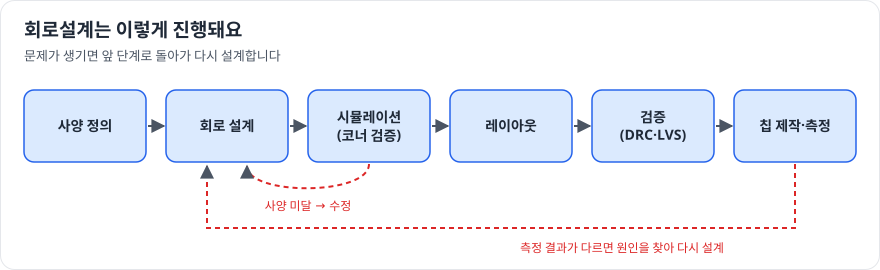

# 회로설계

> 확인 기준일: 2026-10-28 · 공식 직무소개: <https://www.samsung-dsrecruit.com/recruits/job_intro/index.php>

## 1. 이 직무는 무슨 일을 하나

반도체 칩 안에 들어갈 **회로를 설계하고 검증하는 일**입니다. 제품 사양(속도, 전력, 면적)을 받아서, 그 사양을 만족하는 회로를 만들고 시뮬레이션으로 확인한 뒤 실제 칩으로 만들 수 있는 형태(레이아웃)로 넘깁니다.

회로설계는 크게 두 갈래로 나뉩니다.

| 갈래 | 다루는 것 | 주로 쓰는 도구 |
|---|---|---|
| **아날로그/혼성신호** | 증폭기, 전원 회로, 클럭 생성 회로(PLL), 고속 입출력, 데이터 변환기(ADC/DAC) | 회로 시뮬레이터(SPICE 계열), 회로도 편집기 |
| **디지털** | 로직, 제어기, 프로세서, 메모리 컨트롤러 | 하드웨어 기술 언어(Verilog/SystemVerilog), 논리 합성·검증 도구 |

메모리 제품이라면 셀 주변의 감지 증폭기, 입출력 인터페이스, 내부 전원 회로를 설계합니다. 시스템반도체라면 프로세서나 이미지센서의 신호 처리 회로를 설계합니다.

### 하루 업무 예시

- 오전: 새 버전 회로의 시뮬레이션 결과 확인. 온도·전압·공정 편차 조건(코너)별로 사양을 만족하는지 점검
- 점심 후: 레이아웃 담당자와 배선 때문에 생긴 성능 저하를 논의
- 오후: 지난 칩의 측정 결과와 시뮬레이션 결과가 다른 부분을 분석하고 회로 수정안 작성
- 저녁 전: 사양 변경 회의에서 전력과 속도의 트레이드오프를 설명

## 2. 필요한 역량 지도

| 구분 | 역량 | 어느 정도까지 |
|---|---|---|
| 전공지식 | 회로이론, 전자회로, 반도체소자 | MOSFET 동작 영역과 소신호 모델로 기본 증폭기를 손으로 해석할 수 있을 것 |
| 전공지식 | 디지털논리회로, 컴퓨터구조 | 조합·순차 회로, 타이밍(셋업·홀드)을 설명할 수 있을 것 |
| 전공지식 | 신호및시스템, 제어공학 (아날로그 지망 시) | 주파수 응답, 안정도(위상 여유)를 해석할 수 있을 것 |
| 툴·실무 스킬 | SPICE 시뮬레이션 | 회로도를 그리고 DC·AC·과도 해석을 직접 돌려 본 경험 |
| 툴·실무 스킬 | Verilog / SystemVerilog (디지털 지망 시) | 모듈 설계와 테스트벤치 작성, 파형으로 디버깅한 경험 |
| 툴·실무 스킬 | 스크립트 (Python, Tcl, Shell) | 시뮬레이션 결과 정리와 반복 작업 자동화 |
| 소프트 스킬 | 트레이드오프 설명 | "왜 이 설계를 골랐는가"를 수치로 말하는 능력 |
| 소프트 스킬 | 협업 | 레이아웃, 공정, 평가 직무와 문제를 함께 푸는 태도 |

## 3. 학습 로드맵

학년이나 남은 기간에 맞춰 조절하세요. 기간은 학기 중에 다른 과목과 병행하는 경우를 기준으로 한 대략적인 가이드입니다.

### 1단계: 입문 (1~2개월)

목표: **"트랜지스터 하나가 어떻게 증폭기·스위치가 되는가"를 그림으로 설명할 수 있다.**

- 회로이론 복습: 키르히호프 법칙, 테브난 등가회로, RC 회로의 시간 응답
- 반도체소자 기초: PN 접합, MOSFET의 동작 영역 (차단, 선형, 포화)
- 무료 시뮬레이터(ngspice, LTspice 중 하나)를 설치하고 인버터와 RC 필터를 직접 그려 시뮬레이션

### 2단계: 기본기 (3~4개월)

목표: **교과서 수준의 기본 회로를 손 계산과 시뮬레이션 두 가지로 해석한다.**

- 아날로그: 공통 소스 증폭기, 전류 거울, 차동 증폭기, 2단 연산증폭기
    - 손 계산한 이득과 시뮬레이션 결과를 비교하고, 차이가 나는 이유를 적어 보기
- 디지털: Verilog로 카운터, 유한상태기계(FSM), FIFO를 만들고 테스트벤치로 검증
    - 온라인 연습 사이트(HDLBits 등)에서 문제를 꾸준히 풀기
- 공통: 셋업·홀드 타임, 파이프라인, 전력 소모(동적·정적)의 개념 정리

### 3단계: 심화 (3~6개월)

목표: **한 갈래를 골라 "사양 → 설계 → 검증"을 끝까지 해 본다.**

- 아날로그 지망: 밴드갭 기준전압, LDO 레귤레이터, 비교기, 간단한 PLL의 블록 동작
    - 코너 시뮬레이션(온도·전압·공정 편차)과 몬테카를로 해석의 의미 익히기
- 디지털 지망: 간단한 RISC-V CPU 코어 또는 UART·SPI 같은 통신 블록 설계
    - 오픈소스 합성 도구(Yosys 등)로 합성해 보고, 타이밍 리포트 읽는 법 익히기
- 공통: 대학원 수준 교재의 해당 장 읽기, 학교 연구실 세미나나 학부 연구생 참여 고려

### 4단계: 포트폴리오 (2~3개월)

목표: **설계 결과물과 의사결정 과정을 남에게 보여줄 수 있는 형태로 정리한다.**

- 5번의 프로젝트 중 하나를 골라 GitHub 저장소나 PDF 보고서로 정리
- 각 프로젝트마다 "목표 사양 / 설계 선택과 이유 / 시뮬레이션 결과 / 아쉬운 점과 개선안" 네 칸을 반드시 채우기
- 가능하다면 교내외 칩 설계 교육이나 공모전에서 실제 칩 제작(MPW) 경험 쌓기

## 4. 추천 학습 자료

| 분야 | 자료 | 비고 |
|---|---|---|
| 아날로그 교재 | B. Razavi, *Design of Analog CMOS Integrated Circuits* | 아날로그 회로설계의 표준 교재 |
| 전자회로 교재 | Sedra & Smith, *Microelectronic Circuits* | 학부 전자회로 기본서 |
| 디지털 교재 | Harris & Harris, *Digital Design and Computer Architecture* | Verilog와 컴퓨터구조를 같이 익히기 좋음 |
| 디지털 VLSI | Weste & Harris, *CMOS VLSI Design* | 트랜지스터 수준 디지털 설계 |
| 무료 강의 | KOCW, K-MOOC의 전자회로·반도체 강의 | 한국어 강의, 학교 강의 복습용 |
| 무료 강의 | 유튜브의 대학 공개 강의 (아날로그 IC 설계) | 영어지만 교재 저자 직강이 있는 경우도 있음 |
| 연습 | HDLBits | 브라우저에서 Verilog 문제 풀이 |
| 오픈소스 도구 | ngspice, Xschem, Icarus Verilog, Verilator, Yosys, GTKWave | 모두 무료, 개인 PC에서 실습 가능 |
| 오픈소스 공정 | SkyWater 130nm 같은 공개 PDK | 실제 공정 모델로 회로를 시뮬레이션해 볼 수 있음 |
| 교육 프로그램 | 반도체설계교육센터(IDEC) 교육, 각 대학·지자체 반도체 아카데미 | 상용 설계 도구 실습과 칩 제작 기회가 있는지 확인 |

## 5. 직접 해보는 프로젝트

난이도 순서입니다. 하나를 깊게 하는 편이 여러 개를 얕게 하는 것보다 낫습니다.

1. **CMOS 인버터 특성 분석** (입문)
    트랜지스터 크기 비율을 바꾸며 전달 특성과 지연 시간 변화를 그래프로 정리
2. **2단 연산증폭기 설계** (기본기, 아날로그)
    이득, 대역폭, 위상 여유 목표를 정하고 보상 커패시터를 조정해 사양 맞추기
3. **Verilog로 UART 송수신기 설계** (기본기, 디지털)
    테스트벤치로 다양한 통신 속도에서 검증하고 파형 캡처 첨부
4. **LDO 레귤레이터 설계와 코너 검증** (심화, 아날로그)
    부하 전류 변화에 대한 응답과 온도·공정 코너별 결과 비교
5. **간단한 RISC-V 코어 구현** (심화, 디지털)
    명령어 일부를 구현하고 간단한 프로그램을 돌려 검증, 합성 후 면적·타이밍 리포트 해석

## 6. 자격증·교육 프로그램

회로설계 직무는 자격증보다 **전공 과목 성적과 프로젝트 경험**이 훨씬 중요하게 보입니다. 자격증에 시간을 쓰기보다는 아래를 우선하세요.

- 전공 핵심 과목(전자회로, 반도체소자, 디지털논리) 성적 관리
- 설계 교육 프로그램 수료와 칩 제작 경험
- 학부 연구생, 인턴, 설계 공모전 참여

## 7. 자기소개서·면접에서 보여주는 법

"회로설계를 공부했다"가 아니라 **"이런 문제를 이렇게 판단해서 풀었다"** 를 보여줘야 합니다.

- **STAR 구조로 프로젝트 하나를 깊게**: 상황(사양), 과제(어려웠던 점), 행동(내가 고른 설계와 이유), 결과(수치)
- **트레이드오프를 말하기**: "이득을 올리면 대역폭이 줄어서, 보상 방식을 바꿔 위상 여유 60도를 맞췄다"처럼 구체적으로
- **실패 경험 준비**: 시뮬레이션과 측정이 달랐던 경험, 원인을 어떻게 좁혔는지
- **면접 단골 질문 대비**: MOSFET 동작 영역, 차동 증폭기의 장점, 셋업·홀드 위반 해결법, 전력 소모 줄이는 방법을 칠판에 그리며 설명하는 연습

## 8. 흔한 오해와 체크리스트

**흔한 오해**

- "툴을 다룰 줄 알면 된다" → 툴은 입사 후에 배웁니다. 툴이 낸 결과가 맞는지 손으로 확인할 수 있는 기본기가 더 중요합니다.
- "아날로그와 디지털 둘 다 깊게 해야 한다" → 한 갈래를 깊게 하고, 다른 갈래는 기본 개념을 설명할 수 있으면 충분합니다.
- "석사가 아니면 어렵다" → 학사 신입도 지원할 수 있습니다. 다만 학부 과정에서 프로젝트 경험을 쌓아 두면 경쟁력이 크게 올라갑니다.

**지원 전 체크리스트**

- [ ] MOSFET 동작 영역과 소신호 모델을 그림으로 설명할 수 있다
- [ ] 기본 증폭기 하나를 손 계산과 시뮬레이션으로 비교해 봤다
- [ ] Verilog로 FSM을 만들고 테스트벤치로 검증해 봤다
- [ ] 끝까지 완성한 프로젝트가 하나 이상 있고, 보고서나 저장소로 정리돼 있다
- [ ] 내 프로젝트의 설계 선택 이유를 3분 안에 설명할 수 있다
- [ ] 메모리와 시스템반도체에서 회로설계가 어떻게 다른지 말할 수 있다 ([메모리사업부](../../01-divisions/memory.md) 참고)
