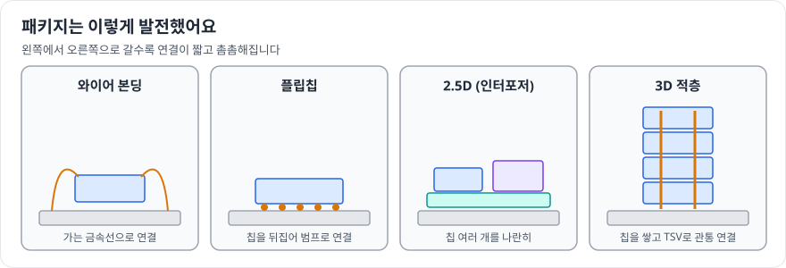

# 패키지개발

> 확인 기준일: 2026-10-28 · 공식 직무소개: <https://www.samsung-dsrecruit.com/recruits/job_intro/memory/packageDev.php>

## 1. 이 직무는 무슨 일을 하나

웨이퍼에서 잘라 낸 칩은 그대로는 쓸 수 없습니다. 칩을 **외부와 전기적으로 연결하고, 열을 빼 주고, 충격과 습기로부터 보호하는 "집"을 설계하고 만드는 일**이 패키지개발입니다.

예전에는 패키지가 "칩을 감싸는 껍데기"였다면, 지금은 **성능을 좌우하는 핵심 기술**입니다. 미세화만으로 성능을 올리기 어려워지면서 여러 칩을 쌓거나 나란히 붙여 하나처럼 동작하게 만드는 **첨단 패키징**이 중요해졌습니다.

| 기술 | 한 줄 설명 |
|---|---|
| 와이어 본딩 | 가는 금속선으로 칩과 기판을 연결하는 전통 방식 |
| 플립칩 | 칩을 뒤집어 범프(작은 돌기)로 기판에 직접 붙이는 방식 |
| TSV | 칩을 수직으로 뚫어 위아래 칩을 연결하는 관통 전극 |
| 2.5D / 3D 패키징 | 여러 칩을 중간 기판(인터포저) 위에 나란히, 또는 위로 쌓아 연결 |
| 하이브리드 본딩 | 범프 없이 구리 면끼리 직접 붙여 더 촘촘하게 연결 |

### 하루 업무 예시

- 오전: 새 패키지 구조의 휨(warpage) 시뮬레이션 결과 검토
- 점심 후: 소재 협력사와 새 접착 소재의 열 특성 데이터 검토
- 오후: 시제품 단면 사진으로 범프 접합 불량 원인 분석
- 저녁 전: 고객사 요구(크기, 두께, 핀 수)를 반영한 패키지 설계안 수정

## 2. 필요한 역량 지도

| 구분 | 역량 | 어느 정도까지 |
|---|---|---|
| 전공지식 | 재료공학 (금속, 고분자, 세라믹) | 열팽창계수 차이가 왜 문제를 일으키는지 설명 |
| 전공지식 | 열전달, 고체역학 | 열 저항, 응력·변형의 기본 계산 |
| 전공지식 | 전자기학, 회로 기초 | 신호 무결성(SI), 전원 무결성(PI)의 개념 |
| 전공지식 | 반도체공정 기초 | 웨이퍼 공정 이후의 후공정 흐름 |
| 툴·실무 스킬 | CAD (2D/3D) | 구조를 도면으로 표현 |
| 툴·실무 스킬 | FEM 해석 | 열·응력 해석을 직접 돌려 본 경험 |
| 툴·실무 스킬 | 분석 장비 이해 | SEM, X-ray, 초음파 검사가 무엇을 보여주는지 |
| 소프트 스킬 | 협업 | 설계, 공정, 소재 협력사, 고객사 사이에서 요구를 조율 |

## 3. 학습 로드맵

### 1단계: 입문 (1~2개월)

목표: **칩이 패키지가 되는 과정을 순서대로 설명할 수 있다.**

- 후공정 흐름 정리: 웨이퍼 테스트 → 절단(다이싱) → 접착 → 연결(본딩) → 밀봉(몰딩) → 최종 테스트
- 패키지 종류별 그림 그리기: 와이어 본딩, 플립칩, 적층

### 2단계: 기본기 (3~4개월)

목표: **패키지에서 생기는 열·기계 문제를 숫자로 다룰 수 있다.**

- 열팽창계수 불일치로 생기는 응력 계산 (이중 재료 휨 공식)
- 열 저항 회로로 칩 온도 추정
- 오픈소스 FEM 도구로 간단한 적층 구조의 열·휨 해석

### 3단계: 심화 (3~6개월)

목표: **첨단 패키징의 과제를 이해하고 자기 언어로 설명한다.**

- HBM, 칩렛, 2.5D/3D 패키징 기술 자료 읽기 (학회 발표, 기술 블로그)
- 신호 무결성 기초: 배선 길이와 신호 지연, 잡음
- 신뢰성 시험: 온도 사이클, 낙하 시험, 습도 시험의 목적

### 4단계: 포트폴리오 (2~3개월)

- 패키지 구조 하나를 정해 "설계 → 해석 → 개선안"을 보고서로 정리
- 첨단 패키징 기술 하나를 깊게 조사한 기술 리뷰 작성

## 4. 추천 학습 자료

| 분야 | 자료 | 비고 |
|---|---|---|
| 패키징 개론 | 반도체 패키징 개론 교재 (국내 출판 교재 다수) | 후공정 전체 흐름 |
| 재료 | 학부 재료역학·재료과학 교재 | 응력, 열팽창 |
| 해석 | 오픈소스 FEM 도구 튜토리얼 | 열·응력 실습 |
| 동향 | 반도체 패키징 관련 학회 공개 자료, 기업 기술 블로그 | 첨단 패키징 이해 |
| 교육 | 대학·지자체 반도체 후공정 아카데미 | 실습 기회 확인 |

## 5. 직접 해보는 프로젝트

1. **이중 재료 휨 계산기** (기본기): 두 재료의 두께와 열팽창계수를 넣으면 휨을 계산하는 코드
2. **칩 적층 구조 열 해석** (기본기): 칩 개수에 따른 최고 온도 변화 분석
3. **첨단 패키징 기술 비교 리포트** (심화): 2.5D, 3D, 하이브리드 본딩의 장단점과 과제 정리
4. **신뢰성 시험 계획서 작성** (심화): 가상의 패키지에 대한 시험 항목, 조건, 판정 기준 설계

## 6. 자격증·교육 프로그램

- 기계·재료 계열이라면 **일반기계기사**, **금속재료기사**가 기본기를 보여주는 데 도움이 될 수 있습니다. 필수는 아닙니다.
- 후공정 실습 교육과 해석 툴 교육 수료가 더 직접적인 경험이 됩니다.

## 7. 자기소개서·면접에서 보여주는 법

- **전공과 패키지를 연결하기**: 기계·재료·화학 전공 지식이 패키지의 어떤 문제를 푸는 데 쓰이는지 구체적으로
- **"왜 지금 패키지가 중요한가"에 자기 의견 갖기**
- **면접 단골 질문 대비**: 열팽창계수 불일치 문제, 와이어 본딩과 플립칩의 차이, HBM이 패키징 기술과 관련된 이유

## 8. 흔한 오해와 체크리스트

**흔한 오해**

- "후공정은 단순 조립이다" → 첨단 패키징은 공정 난이도가 전공정만큼 높고 성능에 직접 영향을 줍니다.
- "전자공학 전공만 간다" → 기계, 재료, 화학 전공의 비중이 큰 직무입니다.

**지원 전 체크리스트**

- [ ] 후공정 흐름을 순서대로 설명할 수 있다
- [ ] 열팽창계수 불일치로 생기는 문제를 예로 들 수 있다
- [ ] 열 또는 응력 해석을 직접 해 봤다
- [ ] 첨단 패키징 기술 하나를 깊게 설명할 수 있다
