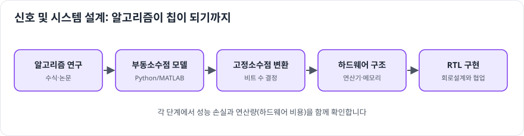

# 신호 및 시스템 설계

> 확인 기준일: 2026-10-28 · 공식 직무소개: <https://www.samsung-dsrecruit.com/recruits/job_intro/slsi/signSystem_design.php>

## 1. 이 직무는 무슨 일을 하나

칩이 처리할 **신호와 데이터를 어떤 방식(알고리즘)으로 다룰지 연구하고, 그 알고리즘을 칩이나 시스템으로 구현할 수 있게 설계하는 일**입니다. 회로설계가 "어떻게 만들까"라면, 신호 및 시스템 설계는 "무엇을 계산하게 할까"에 더 가깝습니다.

| 분야 | 다루는 것 |
|---|---|
| **무선 통신** | 모뎀, Wi-Fi, 블루투스, 위성 측위(GNSS)의 변조·복조, 채널 추정, 오류 정정 |
| **영상·멀티미디어** | 이미지센서 신호 처리(ISP), 영상 압축(코덱), 화질 개선 |
| **AI·딥러닝** | NPU(신경망 가속기)에서 돌아갈 모델과 연산 구조, 모델 경량화 |
| **시스템·인프라** | 여러 블록이 데이터를 주고받는 구조, 성능 모델링, 공장 IT 시스템 설계 |

알고리즘을 만든 뒤에는 고정소수점 변환, 하드웨어 구조 설계까지 이어지는 경우가 많아서, 수학과 하드웨어 양쪽을 이해하는 사람이 강점을 가집니다.

### 하루 업무 예시

- 오전: 새 채널 추정 알고리즘의 시뮬레이션 결과(오류율 곡선) 확인
- 점심 후: 알고리즘을 하드웨어로 만들 때 필요한 곱셈기 수와 메모리 크기를 계산해 회로설계팀과 공유
- 오후: 통신 표준 문서의 새 기능 조항을 읽고 구현 영향 분석
- 저녁 전: 논문 한 편을 읽고 팀 세미나 자료 준비

## 2. 필요한 역량 지도

| 구분 | 역량 | 어느 정도까지 |
|---|---|---|
| 전공지식 | 신호및시스템, 디지털신호처리 | 푸리에 변환, 필터, 샘플링 정리를 설명하고 직접 구현 |
| 전공지식 | 확률과 랜덤 프로세스 | 잡음 모델, 추정 이론의 기초 |
| 전공지식 | 선형대수 | 행렬 연산이 알고리즘에서 어떻게 쓰이는지 |
| 전공지식 | 통신이론 (통신 지망 시) | 변조, 채널 부호화, OFDM, MIMO 개념 |
| 전공지식 | 머신러닝·딥러닝 (AI 지망 시) | CNN, 트랜스포머 구조, 양자화 |
| 툴·실무 스킬 | MATLAB 또는 Python(NumPy) | 알고리즘을 시뮬레이션으로 구현하고 성능 곡선을 그릴 수 있을 것 |
| 툴·실무 스킬 | C/C++ | 알고리즘을 효율적인 코드로 옮길 수 있을 것 |
| 툴·실무 스킬 | 딥러닝 프레임워크 (AI 지망 시) | PyTorch로 모델 학습과 경량화 실습 |
| 소프트 스킬 | 논문·표준 읽기 | 영어 논문과 표준 문서를 읽고 요점을 정리 |

## 3. 학습 로드맵

### 1단계: 입문 (1~2개월)

목표: **신호를 시간과 주파수 두 관점으로 볼 수 있다.**

- 신호및시스템 복습: 선형 시불변 시스템, 컨볼루션, 푸리에 변환
- Python(NumPy, matplotlib)으로 사인파 합성, FFT, 저역통과 필터 구현

### 2단계: 기본기 (3~4개월)

목표: **분야 하나를 골라 교과서 알고리즘을 직접 구현하고 성능을 측정한다.**

- 통신: BPSK/QPSK 변복조 → 잡음 채널 통과 → 비트오류율(BER) 곡선 그리기 → 이론값과 비교
- 영상: 노이즈 제거, 디모자이킹, 감마 보정 같은 ISP 단계를 하나씩 구현
- AI: 작은 CNN 학습 → 8비트 양자화 → 정확도와 연산량 변화 비교

### 3단계: 심화 (3~6개월)

목표: **"알고리즘 → 하드웨어 제약 반영"까지 연결한다.**

- 부동소수점 알고리즘을 고정소수점으로 바꾸고 성능 손실 분석
- 연산량(곱셈·덧셈 수), 메모리 사용량, 지연 시간을 계산하는 습관
- 통신: OFDM, 채널 추정, LDPC 같은 오류 정정 부호
- AI: 모델 경량화(가지치기, 양자화, 지식 증류), NPU 구조 논문 읽기

### 4단계: 포트폴리오 (2~3개월)

- 구현 코드 + 성능 곡선 + "왜 이 방법을 골랐는가" 설명을 저장소로 정리
- 가능하면 논문 하나를 재현하고, 재현 결과와 논문의 차이를 분석

## 4. 추천 학습 자료

| 분야 | 자료 | 비고 |
|---|---|---|
| 신호처리 | Oppenheim, *Signals and Systems*, *Discrete-Time Signal Processing* | 표준 교재 |
| 통신 | 학부 통신이론 교재, KOCW 디지털통신 강의 | 변복조, 채널 부호화 |
| 영상 | Gonzalez & Woods, *Digital Image Processing* | 영상처리 기초 |
| AI | 대학 공개 딥러닝 강의, PyTorch 공식 튜토리얼 | 실습 위주 |
| 표준 | 3GPP 표준 문서 (공개) | 실제 모뎀이 따르는 규격 |
| 도구 | Python(NumPy, SciPy), GNU Octave(무료 MATLAB 대안) | 무료 |

## 5. 직접 해보는 프로젝트

1. **BER 시뮬레이터** (기본기): 여러 변조 방식의 BER 곡선을 이론값과 비교
2. **간이 ISP 파이프라인** (기본기): RAW 이미지를 받아 컬러 이미지로 만드는 단계 구현
3. **OFDM 송수신기 시뮬레이션** (심화): 다중경로 채널, 채널 추정, 등화까지
4. **딥러닝 모델 경량화 실험** (심화): 양자화 전후의 정확도·연산량·메모리 비교표 작성
5. **고정소수점 변환 분석** (심화): FIR 필터를 비트 수별로 구현하고 성능 손실 측정

## 6. 자격증·교육 프로그램

이 직무는 자격증보다 **수학적 기본기와 구현 경험**이 중요합니다. 학부 연구생, 관련 연구실 인턴, 신호처리·AI 경진대회 참여가 더 효과적입니다.

## 7. 자기소개서·면접에서 보여주는 법

- **성능 곡선으로 말하기**: "같은 오류율에서 기존 방식보다 2dB 이득" 같은 수치
- **트레이드오프**: 성능과 연산량(하드웨어 비용) 사이에서 어떤 선택을 했는가
- **면접 단골 질문 대비**: 샘플링 정리와 에일리어싱, FFT가 빠른 이유, OFDM의 장점, 양자화가 정확도에 미치는 영향

## 8. 흔한 오해와 체크리스트

**흔한 오해**

- "소프트웨어 직무다" → 결과물이 결국 칩으로 구현되므로 하드웨어 제약을 이해해야 합니다.
- "AI만 하면 된다" → AI 분야라도 연산 구조와 메모리 접근 같은 하드웨어 관점이 차별점이 됩니다.

**지원 전 체크리스트**

- [ ] 푸리에 변환과 샘플링 정리를 그림으로 설명할 수 있다
- [ ] 한 분야의 기본 알고리즘을 직접 구현하고 성능 곡선을 그려 봤다
- [ ] 알고리즘의 연산량을 계산해 본 적이 있다
- [ ] 영어 논문 한 편을 읽고 요약·재현해 본 경험이 있다
