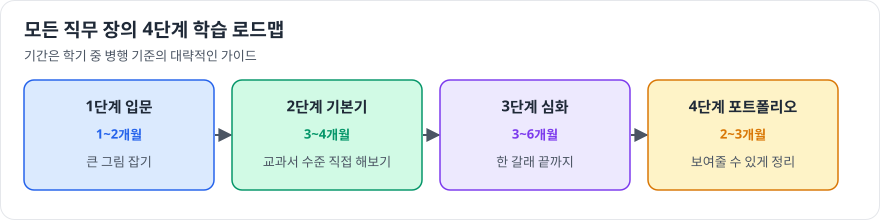

# 2부. 직무 이해와 학습 전략

이 책의 중심입니다. 직무마다 필요한 역량과, 그 역량을 기르는 학습 순서를 정리했습니다.

모든 직무 장의 학습 로드맵은 같은 4단계로 되어 있습니다.

## 설계/개발

- [회로설계](design/circuit-design.md)
- [평가 및 분석](design/test-analysis.md)
- [신호 및 시스템 설계](design/signal-system.md)
- [CAE시뮬레이션](design/cae-simulation.md)
- [패키지개발](design/package.md)
- [기구개발](design/mechanical.md)
- [S/W개발](design/software.md)

## 공정/설비

- [반도체공정설계](process/process-integration.md)
- [반도체공정기술](process/process-engineering.md)
- [설비기술](process/equipment.md)
- [생산관리](process/production-management.md)

## 사업/지원

- [영업마케팅](business/sales-marketing.md)
- [경영지원(재무)](business/finance.md)
- [경영지원(일반)](business/general-management.md)
- [인사](business/hr.md)
- [구매](business/purchasing.md)

## 인프라/안전

- [인프라기술(건설/Facility/전기)](infra/infra-facility.md)
- [인프라기술(Gas/Chemical)](infra/infra-gas-chemical.md)
- [환경](infra/environment.md)
- [안전보건](infra/safety-health.md)
