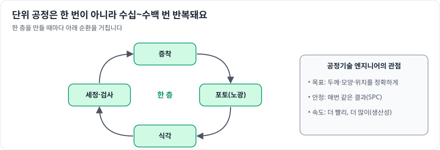

# 반도체공정기술

> 확인 기준일: 2026-10-28 · 공식 직무소개: <https://www.samsung-dsrecruit.com/recruits/job_intro/memory/semiProcess_tech.php>

## 1. 이 직무는 무슨 일을 하나

**포토, 식각, 증착, 세정, 이온 주입, 금속배선 같은 단위 공정 하나를 맡아, 그 공정이 목표대로·안정적으로·빠르게 돌아가게 만드는 일**입니다. 신입 공정 엔지니어 중 가장 많은 인원이 배치되는 대표 직무입니다.

| 단위 공정 | 핵심 과제 |
|---|---|
| **포토 (노광)** | 더 작은 패턴을 정확한 위치에 새기기 (해상도, 정렬, EUV) |
| **식각** | 원하는 부분만 깎아 내기 (선택비, 수직 형상, 깊은 구멍) |
| **증착** | 원하는 두께의 막을 균일하게 쌓기 (CVD, ALD, PVD) |
| **세정·CMP** | 불순물 제거, 표면 평탄화 |
| **이온 주입·열처리** | 원하는 곳에 원하는 농도로 불순물 넣기 |
| **금속배선** | 칩 안의 연결선 만들기 (저항, 신뢰성) |

공식 소개에는 생산 단계뿐 아니라 차세대 공정과 소재 연구, 후공정(조립·테스트) 공정 개선도 포함되어 있습니다.

### 하루 업무 예시

- 오전: 담당 공정의 밤사이 생산 데이터와 이상 경보 확인
- 점심 후: 막 두께 균일도가 떨어진 장비의 원인 분석, 설비 엔지니어와 함께 점검
- 오후: 새 공정 조건(레시피) 실험 결과 평가
- 저녁 전: 공정설계팀에 개선 결과 공유

## 2. 필요한 역량 지도

| 구분 | 역량 | 어느 정도까지 |
|---|---|---|
| 전공지식 | 반도체공정 | 단위 공정의 물리·화학 원리 설명 |
| 전공지식 | 화학, 물리화학 | 반응 속도, 플라즈마, 표면 반응 |
| 전공지식 | 재료과학 | 박막의 성질, 결정 구조, 결함 |
| 전공지식 | 반도체소자 기초 | 공정 결과가 소자에 주는 영향 |
| 툴·실무 스킬 | 데이터 분석 | 공정 데이터의 추세와 이상치 찾기 |
| 툴·실무 스킬 | 통계적 공정관리(SPC), DOE | 공정 안정성 관리와 조건 최적화 |
| 소프트 스킬 | 현장 대응력 | 문제 상황에서 빠르게 원인을 좁히고 조치 |

## 3. 학습 로드맵

### 1단계: 입문 (1~2개월)

목표: **8대 공정 각각을 원리 수준으로 설명할 수 있다.**

- 8대 공정 흐름과 각 공정의 목적 정리
- 플라즈마의 기본 개념 (식각·증착 모두에 쓰임)

### 2단계: 기본기 (3~4개월)

목표: **관심 공정 하나를 골라 깊게 공부한다.**

- 포토: 해상도 공식(레일리 기준), 노광 파장과 개구수, 포토레지스트
- 식각: 습식과 건식, 등방성과 이방성, 선택비
- 증착: CVD·ALD·PVD의 원리와 차이, 단차 피복성
- 공통: SPC 관리도, DOE 기초

### 3단계: 심화 (3~6개월)

목표: **최신 공정 과제를 이해하고 실습 경험을 쌓는다.**

- EUV 노광, 고종횡비 식각, ALD의 원자층 제어 같은 최신 이슈 조사
- 학교 나노팹이나 반도체 아카데미에서 공정 실습
- 가상의 공정 데이터로 이상 탐지·조건 최적화 분석

### 4단계: 포트폴리오 (2~3개월)

- 공정 실습 보고서 또는 공정 기술 리뷰
- "공정 문제 → 원인 가설 → 실험 → 개선" 구조의 사례 하나 정리

## 4. 추천 학습 자료

| 분야 | 자료 | 비고 |
|---|---|---|
| 공정 | Plummer, *Silicon VLSI Technology*; 국내 반도체공정 교재 | 기본 |
| 플라즈마 | 플라즈마 공학 입문 교재 | 식각·증착 이해 |
| 강의 | KOCW 반도체공정 강의, 기업 기술 블로그의 공정 시리즈 | 입문에 좋음 |
| 실습 | 대학 나노팹, 반도체 아카데미, 정부 지원 공정 교육 | 실무 경험 |
| 통계 | 통계적 품질관리 교재 | SPC, DOE |

## 5. 직접 해보는 프로젝트

1. **8대 공정 요약 노트** (입문): 공정별 원리, 장비, 주요 변수, 대표 불량을 한 장씩
2. **공정 실습 보고서** (심화): 산화·식각·증착 실습 결과를 측정값과 함께 분석
3. **SPC 관리도 분석** (기본기): 공개 제조 데이터로 관리도를 그리고 이상 구간 판정
4. **최신 공정 기술 리뷰** (심화): EUV, ALD, 고종횡비 식각 중 하나

## 6. 자격증·교육 프로그램

- 화학·재료 계열이라면 **화공기사**, **금속재료기사** 등을 준비하는 지원자도 있습니다. 필수는 아닙니다.
- 공정 실습 교육 수료가 가장 직접적인 경험입니다.

## 7. 자기소개서·면접에서 보여주는 법

- **관심 공정 하나를 깊게**: 모든 공정을 얕게 아는 것보다 하나를 깊게 아는 것이 인상적입니다.
- **전공 지식과 공정 연결**: 화학 전공이라면 반응 속도론으로 식각률을 설명하는 식으로
- **면접 단골 질문 대비**: 플라즈마란 무엇인가, ALD와 CVD의 차이, EUV가 필요한 이유, 선택비의 의미

## 8. 흔한 오해와 체크리스트

**흔한 오해**

- "공정기술은 교대 근무만 한다" → 근무 형태는 부서마다 다르므로 공식 채용 공고와 설명회에서 확인하세요.
- "전자공학 전공이 아니면 불리하다" → 화학, 화공, 재료, 물리 전공이 많이 활약하는 직무입니다.

**지원 전 체크리스트**

- [ ] 8대 공정을 원리 수준으로 설명할 수 있다
- [ ] 관심 공정 하나의 최신 과제를 말할 수 있다
- [ ] SPC나 DOE 개념을 예로 설명할 수 있다
- [ ] 공정 실습이나 관련 실험 경험이 있다
