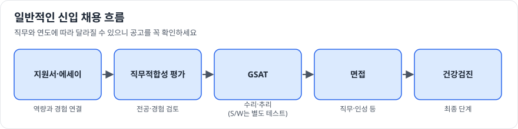

# 5부. 채용 준비

> 확인 기준일: 2026-10-28 · 채용 절차와 일정은 매년 바뀔 수 있습니다. 반드시 [공식 공지사항](https://www.samsung-dsrecruit.com/recruits/notice/index.php)과 [FAQ](https://www.samsung-dsrecruit.com/recruits/faq/index.php), 해당 연도 채용 공고를 확인하세요.

## 일반적인 흐름

삼성 계열사 신입 채용은 일반적으로 아래와 같은 단계로 진행됩니다. 직무에 따라 단계가 다를 수 있습니다.

S/W 관련 직무는 GSAT 대신 별도의 SW 역량 테스트를 보는 경우가 있으니, 지원 직무의 전형을 공고에서 꼭 확인하세요.

## 1. 지원서와 에세이

**핵심: 직무 장의 "필요한 역량 지도"와 내 경험을 1:1로 연결하기**

1. 지원 직무 장의 역량 지도 표를 출력한다
2. 각 역량 옆에 그것을 보여주는 내 경험(수업, 프로젝트, 인턴, 활동)을 적는다
3. 비어 있는 칸은 남은 기간 동안 채울 학습 계획을 세운다
4. 에세이는 가장 강한 경험 2~3개를 STAR 구조로 깊게 쓴다

**자주 하는 실수**

- 회사 칭찬으로 시작하기 → 나의 경험과 직무 연결로 시작하세요
- 경험을 나열하기 → 하나를 깊게, 수치와 판단 근거를 포함하세요
- 공식 사이트의 직무 소개 문장을 그대로 옮기기 → 자기 말로 다시 쓰세요

## 2. 전공 과목 관리

이공계 직무는 이수 과목과 성적을 직무 적합성의 근거로 봅니다.

- [전공별 직무 매트릭스](../03-job-matching/major-matrix.md)의 핵심 과목을 우선 수강
- 핵심 과목은 성적뿐 아니라 내용을 면접에서 설명할 수 있게 정리
- 듣지 못한 과목은 온라인 강의로 보완하고, 그 사실을 에세이에서 학습 의지로 보여주기

## 3. 직무적성검사 (GSAT) 준비

- 수리와 추리 영역으로 구성되어 왔습니다. 최신 구성은 공고와 공식 안내를 확인하세요.
- **준비 전략**
    1. 시중 기출 유형 문제집으로 유형 파악 (1~2주)
    2. 취약 유형 집중 연습 (2~4주)
    3. 실전처럼 시간을 재고 모의고사 (시험 전 2주)
- 온라인으로 치르는 경우가 많으므로 환경 점검(PC, 카메라, 조용한 공간)도 미리 해 두세요.

## 4. 면접 준비

면접은 크게 **직무 역량**, **인성**, **창의성·토론** 성격으로 나눠 준비하면 좋습니다. 실제 면접 구성은 연도와 직무에 따라 다릅니다.

### 직무 역량 면접

- 각 직무 장의 "면접 단골 질문 대비" 항목을 모두 칠판에 그리며 설명하는 연습
- 내 프로젝트를 3분, 1분 버전으로 준비
- 전공 기본 개념을 비전공자에게 설명하듯 쉽게 말하는 연습

### 인성 면접

- 에세이에 쓴 모든 경험에 대해 "왜?"를 세 번 물어보고 답 준비
- 실패 경험, 갈등 경험, 협업 경험 각 1개씩

### 공통 상식

모든 직무에서 아래 정도는 설명할 수 있어야 합니다.

- [반도체 8대 공정](../00-intro/semiconductor-overview.md)
- 메모리와 시스템반도체의 차이
- DS부문의 주요 사업부와 제품
- 최근 반도체 산업 이슈 2~3가지와 내 생각

## 5. 남은 기간별 준비 계획

| 남은 기간 | 우선순위 |
|---|---|
| **1년 이상** | 직무 결정 → 핵심 과목 수강 → 학습 로드맵 2~3단계 → 프로젝트 1개 완성 |
| **6개월** | 로드맵 3단계 집중 → 포트폴리오 정리 → 산업 공부 시작 |
| **3개월** | 포트폴리오 마무리 → 에세이 초안 → GSAT 유형 파악 |
| **1개월** | 에세이 완성 → GSAT 실전 연습 → 직무 면접 질문 정리 |
| **면접 2주 전** | 모의 면접 → 프로젝트 설명 연습 → 최신 뉴스 정리 |

## 6. 경력 지원 준비

경력 채용은 신입 채용과 절차와 평가 기준이 다를 수 있습니다. 공식 사이트의 [경력 DS Career Journey](https://www.samsung-dsrecruit.com/recruits/career_journey/index.php)와 [경력 직무추천서비스](https://www.samsung-dsrecruit.com/recruits/job_description/index.php), 그리고 해당 공고를 먼저 확인하세요.

**경력을 직무 언어로 다시 정리하기**

1. 지원 직무 장의 "필요한 역량 지도" 표를 옆에 둡니다.
2. 지금까지 한 프로젝트를 역량별로 나눠 적습니다. 회사 내부 용어 대신 업계에서 통하는 용어로 바꿉니다.
3. 각 프로젝트에 **내 역할, 판단의 근거, 수치로 된 결과**를 붙입니다.
4. 비어 있는 역량은 해당 직무 장의 3단계(심화) 학습 자료로 보완 계획을 세웁니다.

**경력 지원자가 자주 받는 질문**

- 지금 하는 일과 지원 직무가 어떻게 이어지는가
- 가장 어려웠던 기술 문제와 해결 과정 (가설, 데이터, 결과)
- 이 사업부의 제품·기술 이슈에 내 경험을 어떻게 쓸 수 있는가 ([1부](../01-divisions/index.md) 참고)
- 왜 지금 옮기려 하는가

**주의할 점**

- 전 직장의 기밀 정보, 내부 자료, 고객 정보는 지원서와 면접에서 절대 쓰지 마세요. 공개된 수준으로 바꿔 설명해야 합니다.

## 7. 정보 출처 고르기

- **1순위**: 공식 채용 사이트, 채용 공고, 공식 설명회
- **2순위**: 회사 공식 뉴스룸, IR 자료, 기술 블로그
- **참고만**: 취업 커뮤니티 후기 (연도·직무·개인차가 크므로 그대로 믿지 않기)
