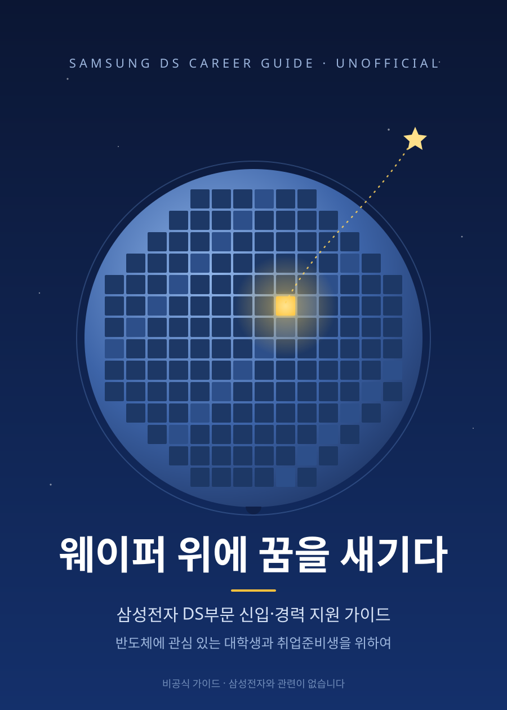

# 웨이퍼 위에 꿈을 새기다

{ width="420" }

**삼성전자 DS부문 신입·경력 지원 가이드 (비공식)**

이 책은 삼성전자 반도체에 관심 있는 대학생과 취업준비생을 위해 만들었습니다. 반도체 산업과 사업부를 처음 접하는 분도 따라올 수 있도록, 사업부와 직무를 이해하는 것에서 시작해 직무별로 무엇을 어떤 순서로 공부하면 좋을지까지 안내합니다.

> 이 책은 삼성전자와 관련 없는 비공식 가이드입니다. 최신 정보는 [공식 채용 사이트](https://www.samsung-dsrecruit.com)에서 확인하세요.

## 누구를 위한 책인가

반도체에 관심 있는 대학생이라면 전공과 진로를 정하는 데, 취업준비생이라면 지원 직무를 고르고 준비하는 데 이 책을 쓸 수 있습니다. 경력으로 지원하려는 분에게도 도움이 되도록 내용을 함께 담았습니다.

| 독자 | 이 책에서 얻을 수 있는 것 |
|---|---|
| **대학생** (저학년~고학년) | 반도체 산업과 사업부, 직무를 미리 알고, 어떤 과목과 프로젝트를 준비하면 좋을지 방향을 잡습니다. |
| **신입 지원자** (취업준비생, 졸업 예정자) | 사업부와 직무를 이해하고, 내 전공에 맞는 직무를 고르고, 지원 전까지 무엇을 공부할지 로드맵을 세웁니다. |
| **경력 지원자** (현업 엔지니어, 이직 준비자) | 지금까지의 경력이 어느 사업부·직무와 이어지는지 확인하고, 부족한 역량을 채울 학습 계획과 경력 정리 방법을 찾습니다. |

## 이 책은 무엇이 다른가

공식 채용 사이트는 "이 직무는 무슨 일을 하는가"를 알려 줍니다.
이 책은 그다음 질문인 **"그 직무가 되려면 무엇을, 어떤 순서로 공부해야 하는가"** 에 답하려고 합니다.

## 구성

| 부 | 내용 |
|---|---|
| [들어가며](00-intro/how-to-read.md) | 읽는 법, 반도체 산업 한눈에 보기 |
| [1부. 사업부 이해](01-divisions/index.md) | DS부문 9개 사업부·조직 |
| [2부. 직무 이해와 학습 전략](02-jobs/index.md) | 20개 직무별 역량 지도와 학습 로드맵 |
| [3부. 나에게 맞는 직무 찾기](03-job-matching/index.md) | 전공·흥미로 직무 좁히기 |
| [4부. 복리후생](04-benefits/index.md) | 복리후생 항목 정리 |
| [5부. 채용 준비](05-recruiting/index.md) | 채용 단계별 준비 전략 |

## 라이선스

이 책의 내용은 [CC BY-NC-SA 4.0](https://creativecommons.org/licenses/by-nc-sa/4.0/deed.ko)을 따릅니다.
